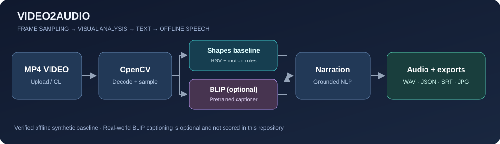
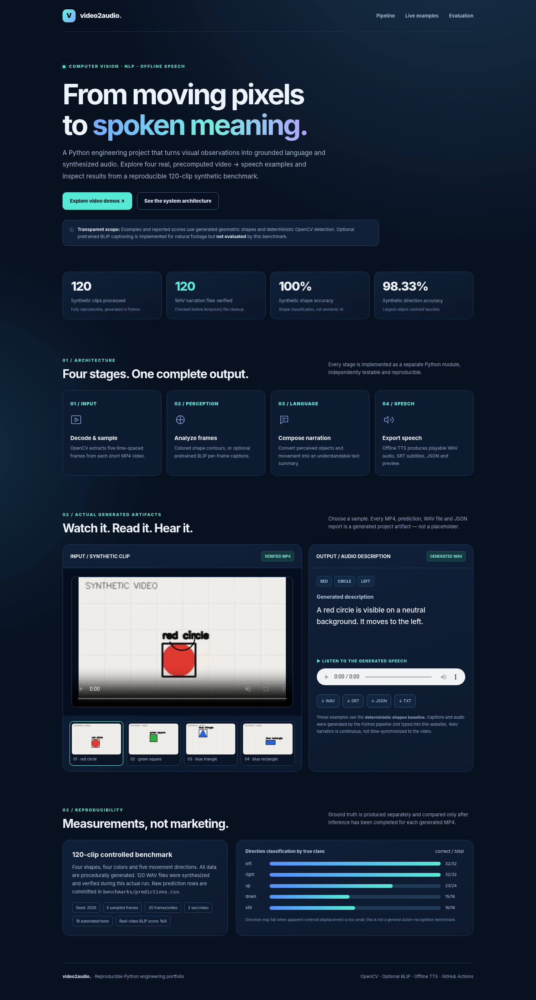

# Video2Audio — Video-to-Audio Description System

**Computer Vision · Vision–Language Models (optional) · NLP · Text-to-Speech · Python**

A reproducible portfolio project that converts a video into a **visual description and a narrated WAV audio file**. It contains an honest, fully offline computer-vision baseline for synthetic geometric videos, plus an **optional pretrained BLIP image-captioning backend** for natural videos. A polished static demonstration site and a local Gradio interface are included.

> **Scope and integrity:** The published 120-video evaluation covers **procedurally generated colored shapes**, not real-world clips. Its metrics describe the OpenCV shape-detection baseline only. The optional BLIP model is integrated in code, but its real-world captioning accuracy has **not** been benchmarked here. This is a portfolio proof of implementation, not a validated accessibility product.





## Try the project

- **[Interactive portfolio demo (static site)](docs/index.html)** — four actual videos, generated descriptions and playable WAV files. On GitHub, click `docs/index.html` → **Download raw file**, or enable GitHub Pages using **main → /docs**.
- **[Example videos](examples/videos/)** — four procedurally generated, browser-playable H.264 MP4s.
- **[Example results](examples/results/)** — real WAV narration, SRT subtitles, detection previews, TXT and machine-readable JSON for all four examples.
- **[Benchmark metrics](benchmarks/metrics.json)** — the reproducible 120-video synthetic evaluation.

### One-minute quick start

Prerequisites: Python 3.10+, `pip`, and an offline text-to-speech engine: **eSpeak** on Linux (`sudo apt install espeak`), or `pyttsx3` with a working system voice on Windows/macOS. eSpeak is also available on other platforms. MP4 reading requires a functional OpenCV/FFmpeg build.

```bash
# From inside this repository:
python -m venv .venv
# Linux/macOS: source .venv/bin/activate
# Windows PowerShell: .venv\Scripts\Activate.ps1
python -m pip install -e ".[dev,ui]"

# Process an included video end-to-end: MP4 -> description + WAV + JSON + SRT
video2audio describe \
  --input examples/videos/synthetic_000.mp4 \
  --output outputs/my_first_video

# Start the local user interface
python app.py
```

Run the equivalent `video2audio describe --input ... --output ...` command on a single line in Windows PowerShell. Results are saved to `outputs/my_first_video/`: `description.wav`, `description.txt`, `captions.srt`, `preview.jpg`, `result.json`.

### Use real-world footage with a pretrained AI captioner

Install the extra AI packages and download the pretrained weights on first use (internet, disk space and time required):

```bash
python -m pip install -e ".[ai,ui]"
video2audio describe \
  --input path/to/my_own_video.mp4 \
  --output outputs/real_video \
  --backend blip \
  --language en \
  --samples 3
```

The model is `Salesforce/blip-image-captioning-base` (PyTorch + Hugging Face Transformers). Each sampled frame is captioned separately; the project deduplicates captions into a narration and uses an **image-change indicator**, not a general-purpose action recognizer. Pretrained model weights are **not included** in this repository. **Review generated descriptions before using them for accessibility or other consequential purposes.** The BLIP backend currently supports **English output only**.

## End-to-end workflow

| Stage | What actually happens | File / implementation |
| --- | --- | --- |
| 1 · Decode | Read MP4/MOV/AVI/MKV/WEBM; sample up to 32 frames at spaced timestamps | `src/video2audio/video.py` |
| 2 · Perceive | **Shapes:** HSV foreground segmentation + contours; **BLIP:** pretrained frame captioning | `vision.py`, `ai.py` |
| 3 · Describe | Shape/color/motion-to-text rules, or deduplicated BLIP captions | `caption.py` |
| 4 · Narrate | Offline text-to-speech using eSpeak (or pyttsx3 fallback) | `tts.py` |
| 5 · Export | WAV, TXT, JSON provenance, frame-level SRT and annotated JPG preview | `pipeline.py` |
| 6 · Evaluate | Generate new labeled synthetic MP4 clips; run **inference without accessing labels**; compare predictions to truth | `synthetic.py`, `benchmark.py` |

## Verified results: 120 synthetic clips

The benchmark was executed locally from generated video files, and audio files were checked before temporary outputs were deleted. It uses fixed random seed `2026`, `5` sampled frames per video, and `120` procedurally generated clips.

| Measurement | Verified result |
| --- | ---: |
| Synthetic clips processed | **120 / 120** |
| WAV narration files generated and verified | **120 / 120** |
| Synthetic shape-class accuracy | **100.00%** |
| Synthetic color-class accuracy | **100.00%** |
| Synthetic dominant-direction accuracy | **98.33%** |
| Clips of real-world video tested with BLIP | **0 (not evaluated)** |

**These numbers do not generalize to real videos.** They measure a deliberately narrow and controlled synthetic task, not semantic action recognition, human caption ratings or spoken-audio quality. Machine-specific processing-time measurements are in [`benchmarks/metrics.json`](benchmarks/metrics.json).

Reproduce the same experiment:

```bash
video2audio benchmark --count 120 --seed 2026 --output-dir outputs/rebenchmark
# Use --no-audio when eSpeak is unavailable (then audio_files_verified = 0)
# Use --keep-videos to retain all generated MP4 files under outputs/rebenchmark/generated_videos/
```

See [`benchmarks/predictions.csv`](benchmarks/predictions.csv) for **all 120 ground-truth/predicted label pairs**, [`benchmarks/ground_truth.csv`](benchmarks/ground_truth.csv) for the independently generated annotations, and [`docs/DATA_CARD.md`](docs/DATA_CARD.md) for limitations.

## CLI examples

```bash
# Generate a French narration for the offline geometric-shape baseline
video2audio describe --input examples/videos/synthetic_005.mp4 \
  --output outputs/french --backend shapes --language fr

# Process a directory of short clips and obtain a batch_report.json
video2audio batch --input-dir examples/videos --output-dir outputs/all_examples

# Show available commands
video2audio --help
```

The `shapes` backend will **not** meaningfully describe natural footage (it detects only simple, brightly colored shapes). For natural footage, use `--backend blip`, which needs pretrained model weights and can still make mistakes.

## Repository layout

```text
ai-video-to-audio-description/
├── README.md, GUIDE_FR.md, LICENSE
├── pyproject.toml, requirements.txt, requirements-ai.txt
├── app.py                             # Local Gradio upload + WAV playback
├── src/video2audio/
│   ├── video.py                       # Sampling + scene differences
│   ├── vision.py                      # Classical CV detection / motion tracking
│   ├── ai.py                          # Optional pretrained BLIP captioner
│   ├── caption.py                     # Caption generation, SRT
│   ├── tts.py                         # Offline speech synthesis
│   ├── pipeline.py                    # End-to-end processing
│   ├── synthetic.py                   # Reproducible videos + separate labels
│   ├── benchmark.py                   # Real batch inference + metrics
│   └── cli.py                         # Describe / batch / benchmark
├── examples/videos/                  # Four generated MP4 clips
├── examples/results/                 # Four verified narrated outputs
├── benchmarks/                       # 120-case predictions and metrics
├── docs/index.html                   # Static browse/playback demo
├── docs/architecture.svg             # Pipeline visualization
├── docs/DATA_CARD.md, MODEL_CARD.md   # Transparency and limitations
├── scripts/                           # Recreate sample clips and demo site
├── tests/                             # 18 automated tests
└── .github/workflows/tests.yml       # GitHub Actions tests + MP4→WAV smoke
```

## Testing

```bash
python -m pip install -e '.[dev]'
python -m pytest -q
```

**Verified locally:** `18 passed`, using OpenCV synthetic videos and an isolated mocked BLIP interface test. The test suite **does not download** the pretrained BLIP weights; it checks only the integration with a mock. GitHub Actions runs the same tests plus a complete offline MP4-to-WAV smoke test on Ubuntu.

## Engineering decisions & limitations

- **No mislabeled training:** The shape baseline is not called a learned model. It uses interpretable, deterministic OpenCV operations; pretrained BLIP is separately marked as AI.
- **Dataset provenance:** All 120 benchmark clips and labels are synthetically generated by [`synthetic.py`](src/video2audio/synthetic.py). No private footage or unlicensed external data is bundled.
- **No leakage:** Expected labels are read only by benchmark evaluation, never passed to `process_video()`.
- **Frame sampling:** Fast but can miss short events. Motion direction on the shape benchmark compares first/last detected centroid; occlusions and duplicate objects can break tracking.
- **BLIP caveats:** Independent frame captions can hallucinate, omit scene context and confuse event order. Frame difference does not distinguish subject motion from camera movement.
- **Audio caveats:** WAV is one continuous narration of the video, not word-level synchronized audio description. SRT is frame-observation text and separate from WAV timing. eSpeak voices are synthetic and may sound mechanical.
- **No privacy promise:** The program processes video locally; model initialization may download files from Hugging Face on first use. Uploaded content must be used with permission.

See [`docs/MODEL_CARD.md`](docs/MODEL_CARD.md) for deeper analysis, testing gaps, and improvement priorities.

## Ethical CV wording

A statement supported by the artifacts in **this** repository is:

> Built a Python/OpenCV video-to-audio pipeline that generates textual descriptions, SRT subtitles and offline WAV narration; processed **120 synthetic videos** in a reproducible benchmark and integrated an optional pretrained BLIP captioning backend for real footage (not yet benchmarked).

Do **not** claim the 120 clips were real-world videos or that 98.33% reflects semantic accuracy on general footage. See [`GUIDE_FR.md`](GUIDE_FR.md) for precise French instructions and a shorter CV bullet.

## License

The source code and generated synthetic demo assets are published under the [MIT License](LICENSE). Pretrained BLIP weights are **not** redistributed; review the upstream model's own license and usage terms before use.
